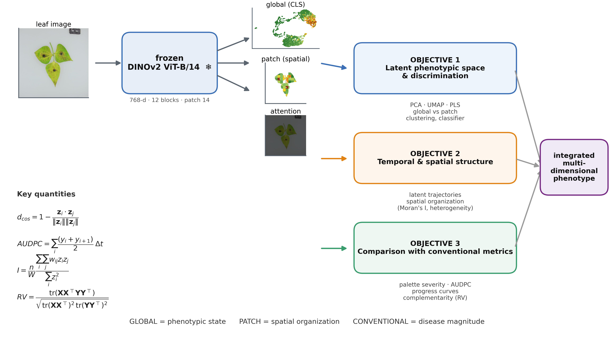
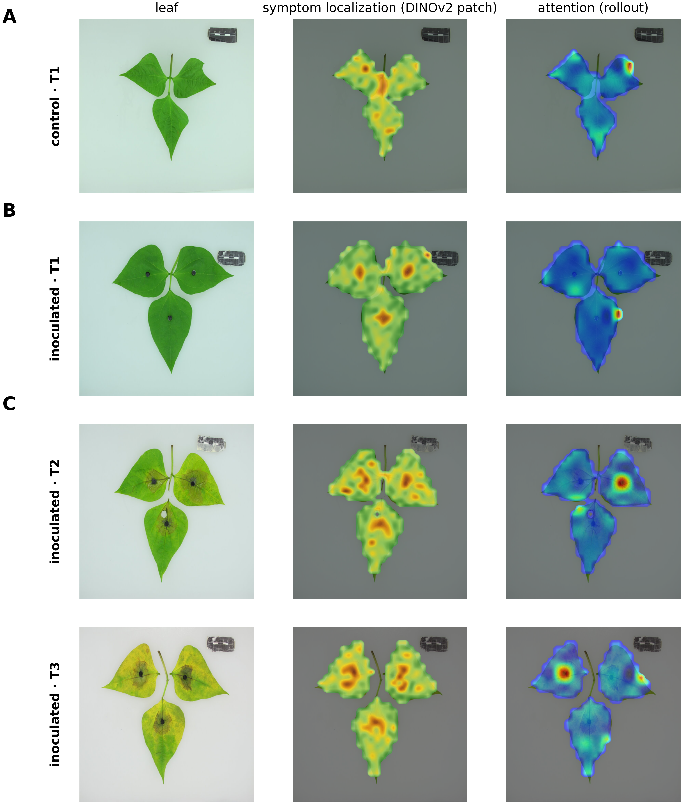
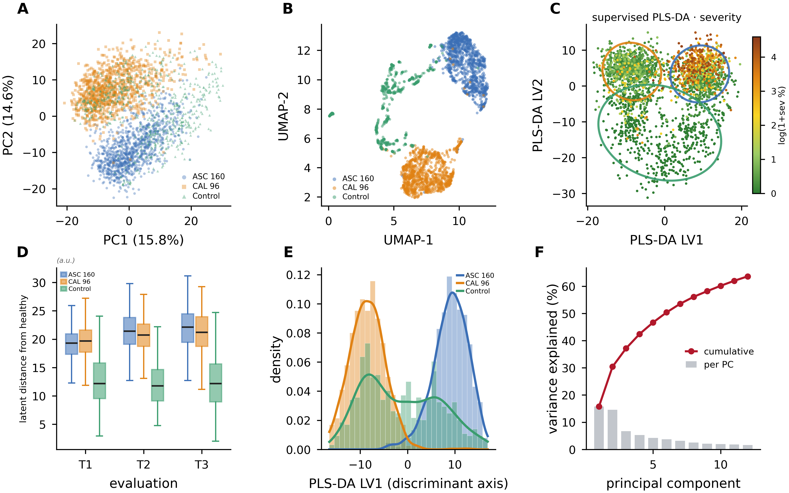
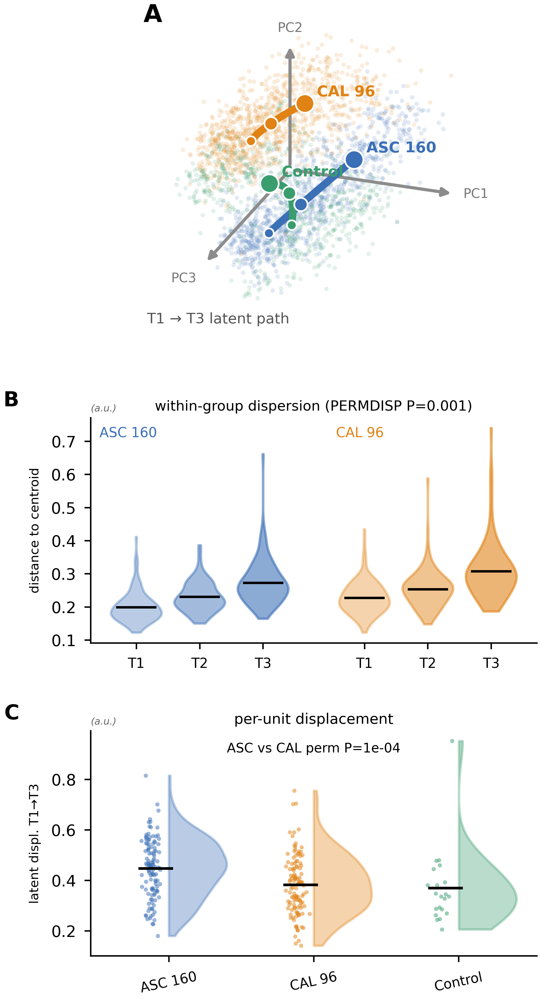
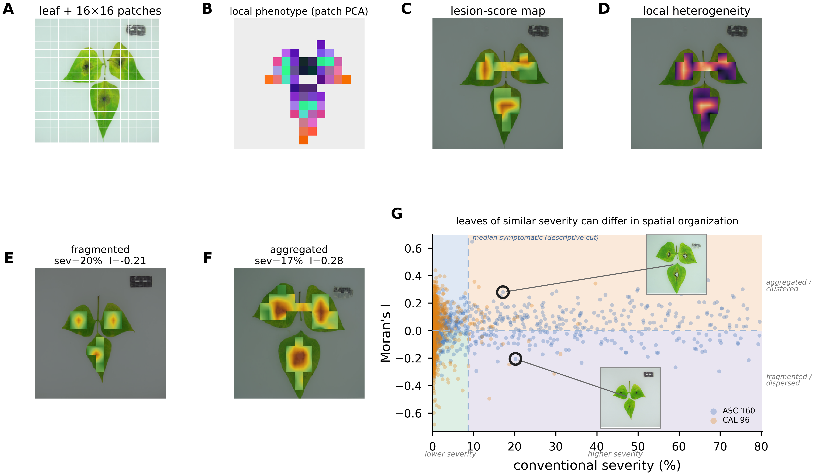
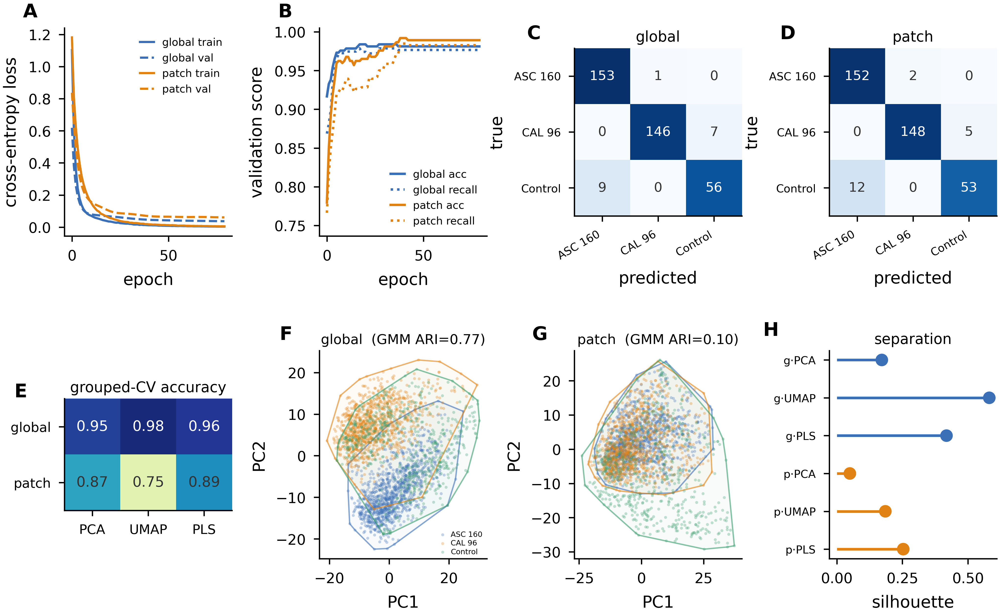
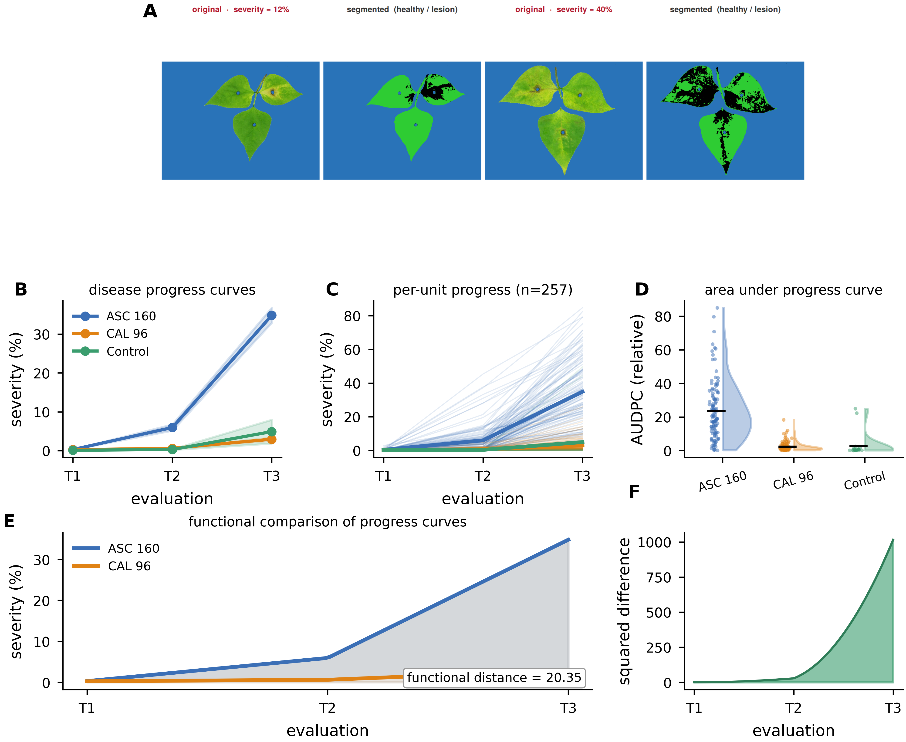
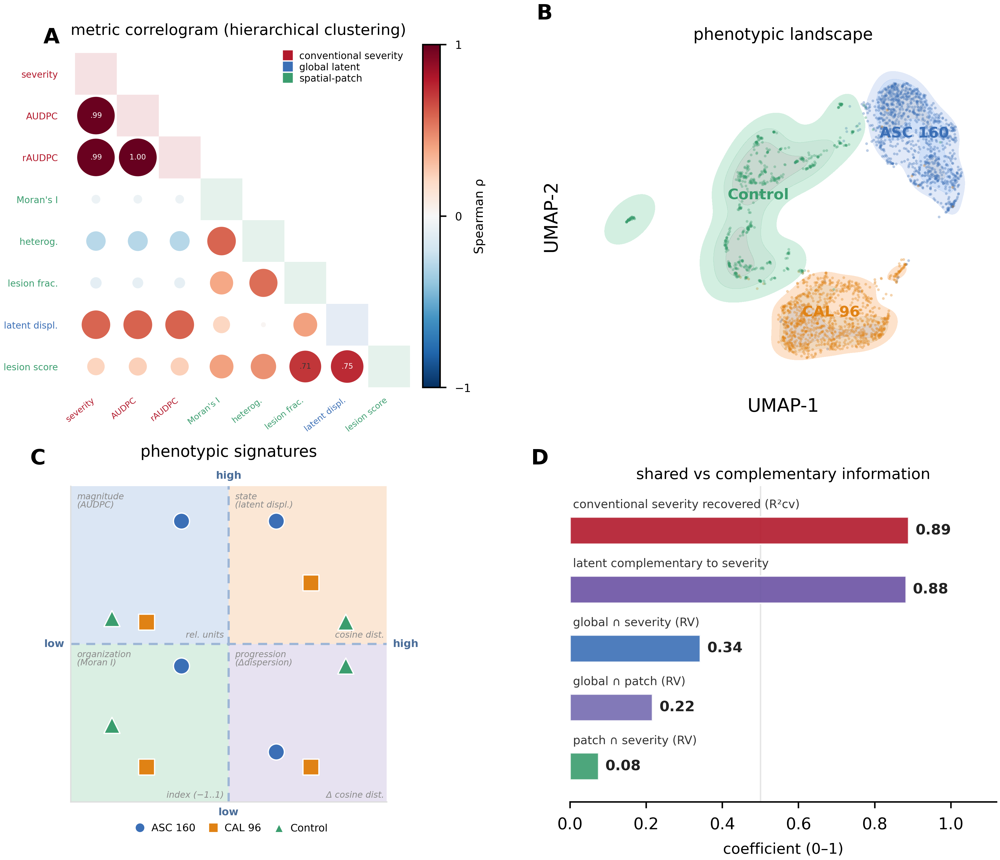

<div align="center">

# 🌱 Latent-Space Phenotyping of the *Phaseolus vulgaris* × *Boeremia* Interaction

### *Navigating between conventional phytopathometry and a multidimensional phenotypic landscape with frozen DINOv2 representations*

[](#)
[](LICENSE)
[](https://www.python.org/)
[](https://www.r-project.org/)
[](https://github.com/facebookresearch/dinov2)
[](https://quarto.org/)
[](#)
[](#)

**🧑‍🔬 Manuel A. Cortés-Quiceno · J. D. Rojas-Villafañez · H. M. Peña-Silgado · L. N. Garzón-Gutiérrez · E. A. Rojas-Triviño**
Universidad Nacional de Colombia (Palmira) · Universidad Industrial de Santander

</div>

---

## 📖 Overview

This repository contains the full, reproducible analysis for the manuscript

> **Navigating between conventional phytopathometry and a multidimensional phenotypic landscape of the *Phaseolus vulgaris* × *Boeremia* spp. interaction from frozen DINOv2 representations.**

We treat the output of a **frozen** DINOv2 ViT-B/14 encoder as a phenotypic space:

- 🧬 the **global class-token** vector captures *what phenotype is present*,
- 🧩 the **patch-token grid** captures *where and how it is organized*,
- 🕒 the **temporal trajectory** across three evaluations captures *how it changes*.

We then benchmark this latent reading against **conventional phytopathometry** (palette-based severity, disease-progress curves, AUDPC) and show the two are **complementary**, not redundant.

**Key finding.** Conventional severity is recovered from the global embedding (R²_CV = 0.89) while **88 % of the latent variance** stays unexplained by severity, and spatial organization is **essentially independent** of severity magnitude (RV = 0.075). Three readings — magnitude, latent state, and spatial organization — describe the same host–pathogen interaction without duplicating information.

---

## 🗂️ Repository Structure

```
.
├── 📄 README.md                     ← you are here
├── 📓 analysis_notebook.qmd         ← Quarto notebook: chunks + figures below
├── 📜 LICENSE                       ← MIT
├── 📑 CITATION.cff                  ← cite-this-repo metadata
├── 🐍 requirements.txt              ← Python deps (pip)
├── 🅒  environment.yml               ← conda environment
├── 🅡  DESCRIPTION                   ← R package deps (renv-friendly)
├── 🧷 .gitignore
│
├── 📁 src/                          ← all analysis + figure scripts
│   ├── 01_build_index.py           — dataset index / QC
│   ├── 04_extract_embeddings.py    — DINOv2 global + patch embeddings
│   ├── 06_attention_demo.py        — attention maps
│   ├── 07_latent_space.py          — PCA / UMAP / PLS-DA
│   ├── 08_trajectories.py          — temporal trajectories (T1→T2→T3)
│   ├── 09_spatial.py               — Moran's I, heterogeneity, lesion maps
│   ├── 10_r4pde_severity.R         — palette-based severity (R)
│   ├── 11_integration.py           — PLS + RV coefficients
│   ├── 12_stats.R                  — PERMANOVA, PERMDISP, LMM
│   ├── 19_classifier.py            — linear probe (70/15/15)
│   ├── 20_clustering_discrim.py    — k-means + GMM (ARI)
│   ├── 21_correlation.py           — cross-metric Spearman
│   ├── fig1_workflow.py … fig8_synthesis.py
│   └── figstyle.py                  — shared matplotlib style
│
├── 📁 figures/                      ← main figures (PNG, 650 dpi)
│   └── supplementary/              — Figure S1–S3 + severity panel
├── 📁 tables/                       ← CSV / JSON tables (Table 1–3 + stats)
├── 📁 docs/
│   └── manuscript/                 — final .docx manuscript + supplement
└── 📁 assets/                       ← badges, logos used by README
```

---

## 🚀 Quickstart

```bash
# 1 — clone
git clone https://github.com/manuelcortes17/dinov2-phaseolus-boeremia-latent-phenotyping.git
cd dinov2-phaseolus-boeremia-latent-phenotyping

# 2 — Python env (pick ONE)
pip install -r requirements.txt
# or
conda env create -f environment.yml && conda activate dinov2-ringspot

# 3 — R deps
Rscript -e 'install.packages(c("vegan","lme4","lmerTest","emmeans","jpeg"))'

# 4 — render the walkthrough notebook (chunks + figures)
quarto render analysis_notebook.qmd      # → analysis_notebook.html

# 5 — or run the pipeline end-to-end
python src/01_build_index.py
python src/04_extract_embeddings.py
Rscript src/10_r4pde_severity.R
python src/11_integration.py
Rscript src/12_stats.R
# ... see analysis_notebook.qmd for the full order
```

> 💡 The project runs on CPU for everything except DINOv2 inference, which benefits from a GPU. Weights are loaded locally from the DINOv2 release (ViT-B/14, 86 M params, 768-d features).

---

## 🧪 Methods at a Glance

| Stage | Script | Output | Figure |
|---|---|---|---|
| 📸 Image indexing & QC | `01_build_index.py` | `outputs/index/master_index.csv` | — |
| 🧠 DINOv2 embeddings (global + patch) | `04_extract_embeddings.py` | `embeddings/global.npy`, `patch_f16.npy` | Fig 1 |
| 👁 Attention & symptom localization | `06_attention_demo.py` | attention overlays | Fig 2, S1 |
| 🗺 Latent space (PCA / UMAP / PLS-DA) | `07_latent_space.py` | `coords.npz` | Fig 3 |
| 🧭 Temporal trajectories | `08_trajectories.py` | `trajectory_metrics.json` | Fig 4 |
| 🧩 Spatial phenotyping (Moran's I) | `09_spatial.py` | `spatial_per_image.csv` | Fig 5 |
| 🏷 Supervised discrimination | `19_classifier.py` + `20_clustering_discrim.py` | `classifier_metrics.json` | Fig 6 |
| 🌿 Conventional severity (R / R4PDE) | `10_r4pde_severity.R` | `severity_per_image.csv`, AUDPC | Fig 7 |
| 🔗 PLS + RV integration | `11_integration.py` | `integration_metrics.json` | Fig 8 |
| 📐 Statistics (PERMANOVA / LMM) | `12_stats.R` | tables in `tables/` | Table 2, S1–S5 |

---

## 🖼 Figures

| | | |
|---|---|---|
| **Figure 1** · Workflow | **Figure 2** · Symptom localization | **Figure 3** · Latent phenotypic space |
|  |  |  |
| **Figure 4** · Trajectories | **Figure 5** · Spatial organization | **Figure 6** · Discrimination |
|  |  |  |
| **Figure 7** · Conventional phytopathometry | **Figure 8** · Integrated comparison | |
|  |  | |

Full captions in the manuscript (`docs/manuscript/`). Supplementary figures in `figures/supplementary/`.

---

## 📊 Reproducible Results Package

All reported numbers come from a single frozen results JSON (`frozen/frozen_results.json`), so figures and tables cannot drift from the manuscript text. Re-running any script never silently changes a published number.

---

## 📚 Citation

If you use this code or data layout in your work, please cite:

```bibtex
@article{Cortes-Quiceno2026Boeremia,
  title   = {Navigating between conventional phytopathometry and a multidimensional
             phenotypic landscape of the {Phaseolus vulgaris} × {Boeremia} spp.
             interaction from frozen {DINOv2} representations},
  author  = {Cort{\'e}s-Quiceno, Manuel A. and Rojas-Villafa{\~n}ez, J. D. and
             Pe{\~n}a-Silgado, H. M. and Garz{\'o}n-Guti{\'e}rrez, L. N. and
             Rojas-Trivi{\~n}o, E. A.},
  journal = {Journal of Experimental Botany},
  year    = {2026},
  note    = {Under review}
}
```

See `CITATION.cff` for GitHub's "Cite this repository" button.

---

## 📝 License

Code: **MIT** (see [`LICENSE`](LICENSE)).
Figures, text and tables derived from the manuscript: **CC BY 4.0** upon publication.

---

## 🙏 Acknowledgements

Universidad Nacional de Colombia — sede Palmira · Alliance of Bioversity International & CIAT · Universidad Industrial de Santander. DINOv2 weights © Meta AI (released under the DINOv2 license).

---

<div align="center">

**⭐ If this work is useful to you, please consider starring the repository.**

</div>
